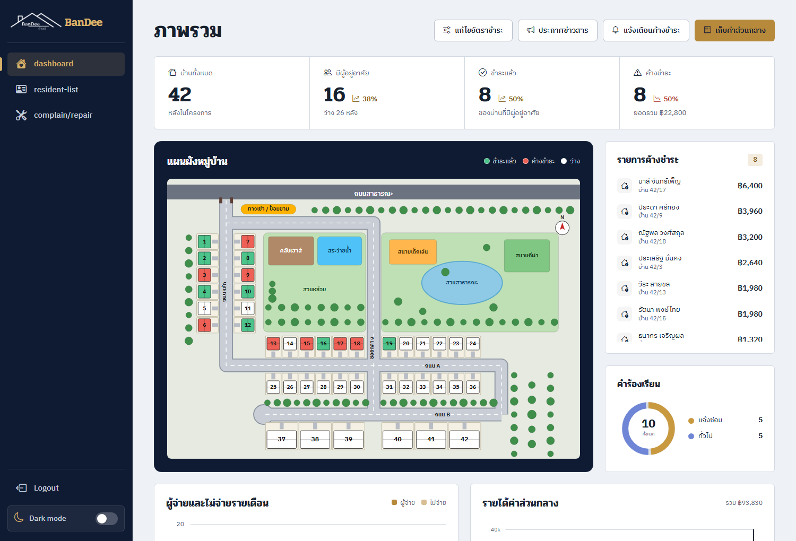
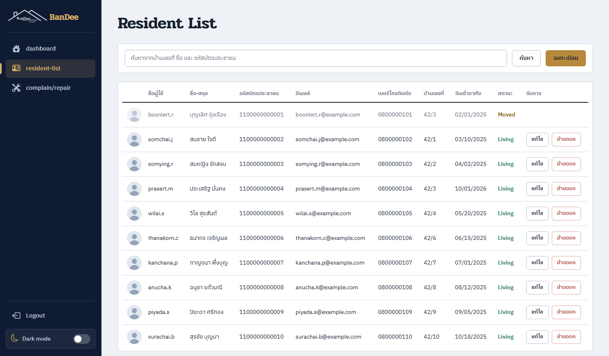
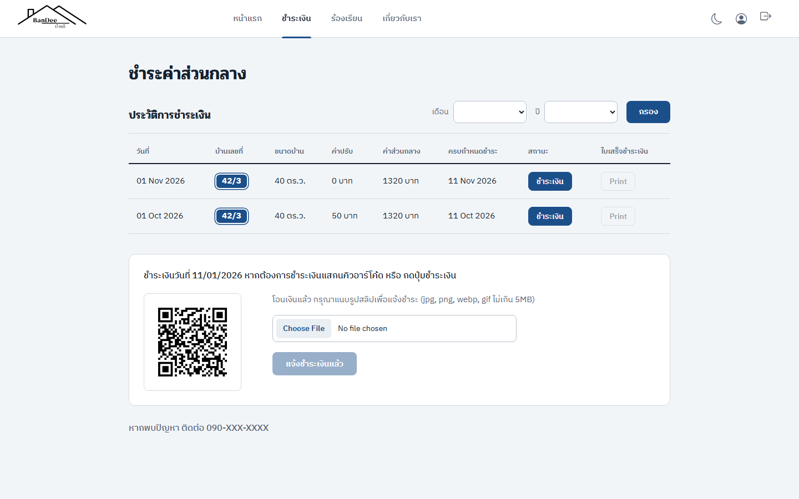
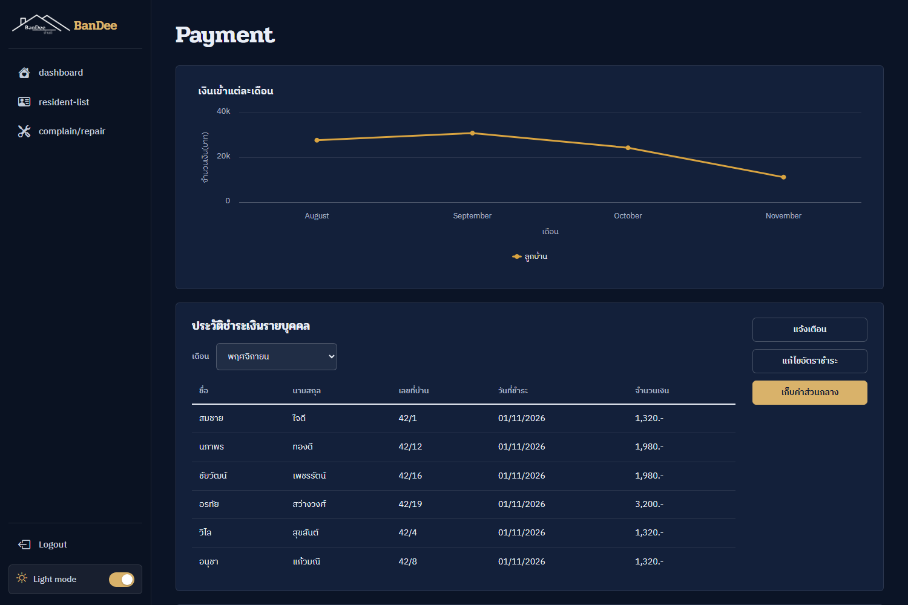
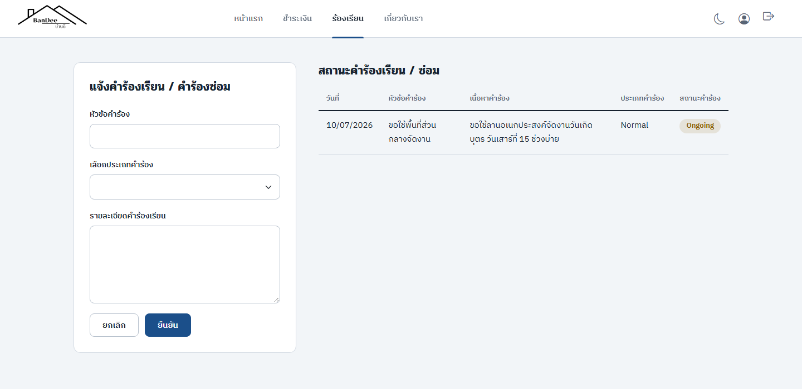

# BanDee — ระบบจัดการค่าส่วนกลางหมู่บ้านจัดสรร

เว็บแอปสำหรับนิติบุคคลหมู่บ้านและลูกบ้าน ครอบคลุมตั้งแต่ออกบิลค่าส่วนกลางรายเดือน รับแจ้งชำระพร้อมสลิป ตรวจและออกใบเสร็จ ติดตามค้างชำระและค่าปรับ ไปจนถึงข่าวประกาศ คำร้องเรียน/แจ้งซ่อม และผังหมู่บ้านที่บอกสถานะการชำระของแต่ละหลัง

เป็นโปรเจกต์ที่เริ่มจากการเรียน (ดู [ที่มาของโปรเจกต์](#ที่มาของโปรเจกต์)) แล้วปรับปรุงต่อเพื่อเป็นผลงาน: ปรับระบบหลังบ้านให้ปลอดภัยขึ้น เพิ่มการแนบสลิป ย้ายออกลูกบ้าน ชุดข้อมูลสาธิต และออกแบบหน้าตาใหม่ทั้งสองฝั่ง

| ผู้ดูแล (admin) | ลูกบ้าน |
|---|---|
|  |  |
|  |  |
|  |  |

## ที่มาของโปรเจกต์

โปรเจกต์นี้เป็นส่วนหนึ่งของวิชา

| รหัสวิชา | วิชา | ส่วนที่เกี่ยวข้องในโปรเจกต์ |
|---|---|---|
| 02739323 | การวิเคราะห์และออกแบบระบบสารสนเทศ (Information System Analysis and Design) | โจทย์ระบบจัดการค่าส่วนกลาง, ผู้ใช้และกระบวนการ (ออกบิล, แจ้งชำระ, ตรวจสลิป, คำร้อง) |
| 02739422 | ระบบฐานข้อมูล (Database System) | การออกแบบฐานข้อมูล SQL Server: ตาราง, ความสัมพันธ์, view, stored procedure, trigger |
| 02739312 | การโปรแกรมบนอินเทอร์เน็ต (Internet Programming) | เว็บแอป Angular + REST API (Express), การยืนยันตัวตนด้วย JWT |

## ฟีเจอร์

**ลูกบ้าน**
- เข้าสู่ระบบ, ลืมรหัสผ่าน (ขอรหัสยืนยัน 6 หลักทางอีเมลแล้วตั้งรหัสใหม่), แก้ไขโปรไฟล์และเปลี่ยนรหัสผ่าน
- ดูบิลและประวัติการชำระ กรองตามเดือน/ปี
- ชำระผ่าน PromptPay QR (ยอดคำนวณจากบิลที่เซิร์ฟเวอร์) แล้วแนบสลิปเพื่อแจ้งชำระ
- พิมพ์ใบเสร็จเป็น PDF (jsPDF)
- แจ้งคำร้องเรียน/คำร้องซ่อม และติดตามสถานะ
- อ่านข่าวประกาศ, โหมดมืด

**ผู้ดูแล (admin)**
- แดชบอร์ด: ตัวเลขสรุป, ผังหมู่บ้าน (SVG) ที่แสดงสถานะรายหลัง, รายการค้างชำระ, กราฟผู้จ่าย/ไม่จ่ายรายเดือน, กราฟรายได้, สัดส่วนคำร้อง, ประวัติการชำระ
- ออกบิลรายเดือน (กันออกซ้ำในเดือนเดียวกัน, ออกเฉพาะลูกบ้านที่ยังอาศัยอยู่) พร้อมส่งอีเมลแจ้ง และส่งอีเมลเตือนค้างชำระ
- ตรวจสลิป: ดูสลิปแล้วยืนยันรับเงิน (ออกใบเสร็จอัตโนมัติ) หรือปฏิเสธ (บิลกลับเป็นค้างชำระ ลูกบ้านแนบใหม่ได้)
- แก้ไขอัตราค่าส่วนกลางและค่าปรับตามขนาดบ้าน
- จัดการลูกบ้าน: ตารางพร้อมค้นหา (ชื่อ, บ้านเลขที่, เบอร์, เลขบัตร ฯลฯ) แบ่งหน้า, ลงทะเบียน (ส่งรหัสผ่านชั่วคราวทางอีเมล), แก้ไขข้อมูล, ย้ายออก (ย้ายไม่ได้ถ้ายังมีบิลค้าง; บ้านกลับเป็นว่าง; บัญชียังดูประวัติเก่าได้)
- จัดการคำร้อง (สลับสถานะ Ongoing/Finish) และข่าวประกาศ (เพิ่ม/แก้ไข/ซ่อน พร้อมรูป)
- โหมดมืด

**ระบบหลังบ้าน**
- ค่าปรับของบิลที่เลยกำหนดคำนวณอัตโนมัติวันละครั้ง (ตั้งค่าตรงๆ ตามขนาดบ้าน ไม่บวกซ้ำ)
- ตั้งเวลาออกบิลอัตโนมัติได้ (ปิดไว้เป็นค่าเริ่มต้น เปิดด้วย `AUTO_BILL=true`)

## เทคโนโลยี

| ส่วน | ใช้ |
|---|---|
| หน้าเว็บ | Angular 18 (SSR), Bootstrap 5 + Bootstrap Icons, Highcharts, SweetAlert2, jsPDF, angularx-qrcode, jwt-decode |
| API | Node.js, Express 4, JWT (jsonwebtoken), bcrypt, multer, nodemailer, promptpay-qr + qrcode |
| ฐานข้อมูล | Microsoft SQL Server (ไดรเวอร์ `mssql`/tedious) |
| ตัวอักษร | Pridi (หัวข้อ) + IBM Plex Sans Thai (เนื้อหา) |

## สถาปัตยกรรมและฐานข้อมูล

```
Angular (4200)  ──HTTP + JWT──▶  Express API (3500)  ──mssql──▶  SQL Server
   │                                  │
   └─ ลูกบ้าน / admin (guard ตาม role)  ├─ public/            รูปโปรไฟล์/ประกาศ
                                       └─ private/slips/    สลิป (ดูได้เฉพาะเจ้าของบิลและ admin)
```

- **10 ตาราง:** `UserAccount`, `villagemanager`, `PriceandSize`, `House`, `Resident`, `PayCommonfee` (บิล), `Payment`, `Receipt`, `Petition`, `Announcement`
- **6 view:** `Resident_info`, `PaymentHistoryView`, `ReceiptView`, `PetitionViewForAdmin`, `HouseStatusView`, `Notificationview`
- **3 stored procedure:** `SendBill` (ออกบิล), `UpdateFine` (ค่าปรับ), `UpdatePayment` (บันทึกการรับเงินและออกใบเสร็จ)
- **3 trigger:** `FeePayment` (เติมยอด = ขนาดที่ดิน × อัตรา, บ้านเลขที่, กำหนดชำระ = +10 วัน ตอนสร้างบิล), `Pettition` (เติมบ้านเลขที่ในคำร้อง), `updatename` (ซิงก์ชื่อ)

**วงจรของบิล:** `Overdue` → ลูกบ้านแจ้งชำระพร้อมสลิป → `Pending` → admin ยืนยัน → `Paid` + ใบเสร็จ (หรือปฏิเสธ → กลับเป็น `Overdue` และล้างสลิป) สถานะเปลี่ยนด้วย `UPDATE ... WHERE สถานะเดิม` ในธุรกรรมเดียว จึงกดซ้ำหรือชนกันไม่ได้ สลิปใบเดียวกันใช้กับบิลอื่นไม่ได้ (เก็บ SHA-256 ไว้เทียบ)

## เริ่มใช้งาน

**ต้องมี:** Node.js, SQL Server ที่เปิด TCP และใช้ SQL Authentication (ตัวอย่างพอร์ต 1433)

1. **สร้างฐานข้อมูล** รัน [real api/sql/schema.sql](real%20api/sql/schema.sql) ด้วย SSMS / Azure Data Studio หรือ
   `sqlcmd -S localhost,1433 -U <user> -P <password> -i "real api/sql/schema.sql"`
2. **ตั้งค่า API**
   ```bash
   cd "real api"
   npm install
   cp .env.example .env     # แล้วกรอกค่าตามตารางด้านล่าง
   ```
3. **ใส่ข้อมูลสาธิต** (ลบข้อมูลเดิมทั้งหมดก่อนสร้างใหม่ ใช้กับฐานข้อมูลสำหรับทดลองเท่านั้น)
   ```bash
   node sql/seed-mock.js --yes
   ```
4. **รัน API** (พอร์ต 3500)
   ```bash
   npm start
   ```
5. **รันหน้าเว็บ** (เปิดเทอร์มินัลใหม่)
   ```bash
   cd Commonfee
   npm install
   npm start                # http://localhost:4200
   ```

**ตัวแปรใน `.env`**

| ตัวแปร | ความหมาย |
|---|---|
| `DB_USER`, `DB_PASSWORD`, `DB_NAME`, `DB_PORT` | การเชื่อมต่อ SQL Server (เซิร์ฟเวอร์ใช้ `localhost`) |
| `JWT_SECRET` | ความลับของ JWT อย่างน้อย 16 ตัวอักษร (ไม่ตั้ง API จะไม่เริ่มทำงาน) |
| `EMAIL_USER`, `EMAIL_PASS` | บัญชี Gmail (App Password) สำหรับส่งอีเมลแจ้งบิล/รหัสยืนยัน |
| `PROMPTPAY_PHONE` | เบอร์ PromptPay 10 หลักที่ใช้สร้าง QR รับเงิน |
| `AUTO_BILL`, `BILL_DAY` | (ไม่บังคับ) เปิดออกบิลอัตโนมัติและกำหนดวันที่ของเดือน |

### บัญชีสำหรับทดลอง

ชุดข้อมูลสาธิตมีบ้าน 20 หลัง ลูกบ้าน 16 คนที่อาศัยอยู่ และ 1 คนที่ย้ายออกแล้ว พร้อมบิล 4 เดือน ใบเสร็จ คำร้อง และข่าว ทุกบัญชีใช้รหัสผ่าน `1234`

| บทบาท | ชื่อผู้ใช้ |
|---|---|
| admin | `admin` (ถ้าสร้างฐานข้อมูลใหม่จาก `schema.sql`) |
| ลูกบ้าน | `somchai.j`, `somying.r`, `prasert.m` (มีบิลค้าง), `wilai.s`, `piyada.s` ฯลฯ |
| ลูกบ้านที่ย้ายออก | `boonlert.r` (ล็อกอินดูประวัติเก่าได้) |

> รหัสผ่าน `1234` มีไว้สำหรับทดลองในเครื่องเท่านั้น อีเมลของข้อมูลสาธิตเป็น `@example.com` ระบบจึงไม่ส่งอีเมลถึงใครจริง ถ้าจะลองฟีเจอร์ขอรหัสยืนยัน ให้เปลี่ยนอีเมลของบัญชีหนึ่งเป็นอีเมลจริงที่หน้าแก้ไขโปรไฟล์

## โครงสร้างโปรเจกต์

```
.
├─ Commonfee/                  หน้าเว็บ Angular
│  └─ src/app/
│     ├─ admin/                dashboard, resident-list, payment, complain-repair, admin-sidebar
│     ├─ user/                 home, purchase, Residentreport, about-us, edit-profile, login, forgotpass, header
│     ├─ service/              ban-dee.service (เรียก API), auth.service, auth.interceptor
│     └─ model/                interface ของข้อมูล
├─ real api/                   API (Express)
│  ├─ controller/  routes/     ตรรกะและเส้นทางของแต่ละส่วน
│  ├─ middleware/              auth (JWT/role), upload, validate
│  ├─ utils/                   mailer, billScheduler
│  └─ sql/                     schema.sql, seed-mock.js, fixes.sql, phase2.sql
└─ docs/screenshots/           ภาพหน้าจอ
```

## ภาพรวม API

| กลุ่ม | เส้นทาง (เมธอด) | สิทธิ์ |
|---|---|---|
| ยืนยันตัวตน | `/login` (POST), `/forgotpass/request` (POST), `/updatepass` (PUT) | สาธารณะ |
| โปรไฟล์ | `/userinfo`, `/updateprofile`, `/changepassbytoken` | ลูกบ้าน |
| บิลของฉัน | `/paymenthistory`, `/searchpayment`, `/pay/:payId` (PUT แนบสลิป), `/gpromptpay`, `/getreceipt/:payId`, `/slip/:payId` | login (เจ้าของบิลหรือ admin) |
| คำร้อง | `/petition` (POST), `/getpetition` | ลูกบ้าน |
| ข่าวและอัตรา | `/getannouce`, `/Fee`, `/AllFee` | สาธารณะ |
| ลูกบ้าน | `/pageresident` (ค้นหา+แบ่งหน้า), `/register` (POST), `/resident/:id` (PUT), `/resident/:id/moveout` (PUT), `/gethouse`, `/housestatus` | admin |
| การเงิน | `/sendBill`, `/getpending`, `/confirmpay/:id`, `/rejectpay/:id`, `/getpaid`, `/getunPaid`, `/changerate`, `/getincome`, `/monthly-payment`, `/paidhistory`, `/unpaidnoti` | admin |
| คำร้อง/ข่าว (admin) | `/getpetitionAdmin`, `/updatepetition/:id`, `/monthly-petition`, `/petitioncount`, `/getpageannouce`, `/addanoucement`, `/editanoucement/:id` | admin |

## ความปลอดภัยที่ทำไว้

- รหัสผ่านเข้ารหัสด้วย bcrypt, JWT หมดอายุ 1 ชั่วโมง, ทุกเส้นทางของ admin ตรวจ role ฝั่งเซิร์ฟเวอร์ (และมี route guard ฝั่งหน้าเว็บ)
- คำสั่ง SQL ทั้งหมดใช้ parameterized query
- สลิปการชำระเงินเก็บนอกโฟลเดอร์ `public` เปิดดูผ่าน API ที่ตรวจสิทธิ์เท่านั้น ตรวจชนิดไฟล์จากเนื้อหาจริง (ไม่เชื่อนามสกุล) จำกัดขนาด 5MB
- ยอดใน PromptPay QR และเบอร์รับเงินกำหนดที่เซิร์ฟเวอร์ ไม่เชื่อค่าที่หน้าเว็บส่งมา
- ระบบลืมรหัสผ่านตอบข้อความเดียวกันไม่ว่ามีบัญชีหรือไม่, รหัสหมดอายุ 10 นาที ผิดได้ไม่เกิน 5 ครั้ง ขอใหม่ได้ทุก 1 นาที

## ข้อจำกัดที่ทราบ

- ที่อยู่ API (`http://localhost:3500`) ฝังอยู่ในโค้ดหน้าเว็บหลายจุด ยังไม่แยกเป็นค่าตั้งค่าตามสภาพแวดล้อม
- ค่าปรับเป็นก้อนเดียวตามขนาดบ้าน (ไม่สะสมตามจำนวนวัน) และรหัสยืนยันลืมรหัสผ่านเก็บในหน่วยความจำ (รีสตาร์ท API แล้วใช้ไม่ได้)
- ยังไม่มีชุดทดสอบอัตโนมัติ (มีเฉพาะไฟล์ `.spec.ts` ที่ CLI สร้างให้)
- หน้าจอมือถือยังไม่ได้ออกแบบ (ออกแบบสำหรับเดสก์ท็อปเป็นหลัก; แถบเมนู admin ย่อเป็นไอคอนได้เมื่อจอแคบ)
- การ์ด "บ้านทั้งหมด" ใน Dashboard นับจากจำนวนแปลงในผังหมู่บ้าน (42) ไม่ใช่จากฐานข้อมูล (ข้อมูลสาธิตมี 20 หลัง)
- หน้า `/adminstatus` (ระบบติดตามลูกหนี้) เป็นหน้าสาธิตที่ใช้ข้อมูลตัวอย่างในโค้ด และไม่อยู่ในเมนู
- ยังไม่มี: บันทึกการแก้ไข (audit log), บันทึกรายจ่ายหมู่บ้าน, ส่งออกรายงานเป็น Excel/PDF

## สคริปต์ SQL

| ไฟล์ | ใช้ทำอะไร |
|---|---|
| `schema.sql` | สร้างฐานข้อมูลทั้งหมด (ตาราง, key, index, view, procedure, trigger, อัตราตั้งต้น) รันซ้ำได้ |
| `seed-mock.js` | ลบแล้วสร้างข้อมูลสาธิต 20 หลัง (ต้องใส่ `--yes`) |
| `fixes.sql`, `phase2.sql` | migration สำหรับฐานข้อมูลเดิม (ฐานข้อมูลใหม่จาก `schema.sql` ไม่ต้องรัน) |
